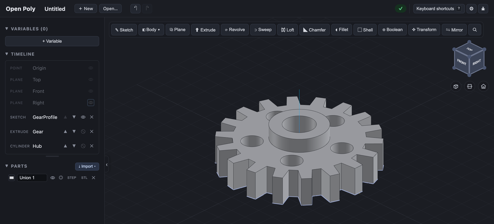

# Open Poly

An open-source, in-browser CAD application that keeps your work on your own machine.

**[Try it → openpoly.dev](https://openpoly.dev)** — no sign-up, no upload, nothing to install.



Open Poly runs entirely in your browser — modeling is powered by the OpenCASCADE geometry kernel (via [replicad](https://replicad.xyz/)) compiled to WebAssembly, rendered with [three.js](https://threejs.org/), with parametric sketch constraints handled by [planegcs](https://github.com/Salusoft89/planegcs). Documents autosave to your browser's IndexedDB — nothing leaves your machine.

The public deployment at <https://openpoly.dev> collects basic anonymous page analytics (no cookies, no personal data, nothing about your documents). Local and self-hosted builds send nothing.

## Requirements

- [Node.js](https://nodejs.org/) 20.19+ or 22.12+ (required by Vite 8)
- npm (ships with Node.js)

## Run

```bash
npm install
npm run dev
```

Vite prints a local URL (default http://localhost:5173) — open it in your browser.

## Create models using your favorite agent

Open Poly comes with a built-in MCP server, so it can be driven by a local LLM agent while you watch it build geometries live in the browser.

**Claude Code** (already wired):

1. Run the app: `npm run dev`, then open the printed URL and leave the tab open.
2. In a Claude Code session for this repo, run `/mcp` to connect `open-poly` (project servers prompt on first use).
3. The app's top bar shows **● Agent connected**. Now ask it to model something:
   > Using the open-poly tools, read the modeling guide, then make a 40×40×10 plate with an 8 mm hole through the middle, and fillet the top edges 2 mm.

**Other clients** (Claude Desktop, Cursor, Cline, …): point them at the same command — `npx -y tsx <absolute-path>/mcp-server/src/index.ts`. See [`mcp-server/README.md`](mcp-server/README.md) for per-client config, the full tool list, and troubleshooting.

Everything stays local: the agent talks to your browser tab over `127.0.0.1`, and every action routes through undo, so you can revert anything it does. Because that is the only address the bridge ever dials, it is inert on the hosted build — <https://openpoly.dev> never attempts to reach an agent.

## Contributing

See [`CONTRIBUTING.md`](CONTRIBUTING.md) for the codebase layout, dev
workflow, and PR process. Design and architecture notes, the gotchas, and what
is not built yet live in [`docs/PLAN.md`](docs/PLAN.md).

## License

GPL-3.0-or-later — see [`LICENSE`](LICENSE). Third-party license notes
(including the LGPL constraint solver and the OCCT geometry kernel) are in
[`NOTICE.md`](NOTICE.md).

The exhaustive per-package list, with each license verbatim, is generated at
build time into `dist/third-party-licenses.txt` — served at
<https://openpoly.dev/third-party-licenses.txt> and linked from the
app's Settings dialog.
